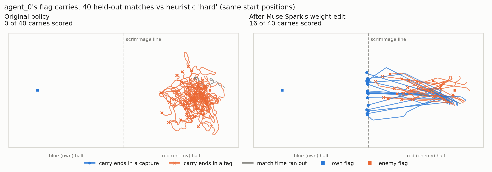

# Admiral: Muse Spark repairs an RL policy by editing its weights

Meta's **Muse Spark** reads the raw weights of a broken multi-agent RL policy, works out why it fails, and rewrites part of the network by hand. It uses no gradients, optimiser or training data fitting. The edited policy is then scored against the original on held-out matches it never saw.

The target is a MAPPO policy for [PyQuaticus](https://github.com/mit-ll-trusted-autonomy/pyquaticus), MIT Lincoln Lab's capture-the-flag simulator for autonomous boats. The policy's attacker grabs the enemy flag about once a match but has **never scored**: while carrying the flag it drifts toward home at 0.28 m/s and picks the stop action 19% of the time, until it is tagged.

In one 30-minute session, Muse Spark found the cause and installed a gated "steer home" reflex in the attacker's network. The edit changed **2.9% of the weights** (4,809 of 163,874). After the edit, the attacker scores on about a third of its flag grabs.



**Demo video (2 min):** https://youtu.be/LiCptMfB24c

This applies *Weight-Space Programming* (MIT CSAIL, Nov 2026) with a different editor. The authors used GPT-6 Astra; this is, as far as I know, the first test with a non-OpenAI editor.

## Results

200 held-out matches per opponent. Both policies play the same start positions (paired comparison), and the confidence intervals are 95% bootstrap intervals. Muse Spark only ever practised against heuristic "hard"; "medium" and the original policy as red are opponents it never played.

| Opponent | W / D / L before | W / D / L after | Score difference, paired change | Captures per grab |
|---|---|---|---|---|
| Heuristic "hard" | 0 / 81 / 119 | 33 / 69 / 98 | **+0.36** (+0.24 to +0.50) | 0.00 → 0.33 |
| Original policy, playing red | 1 / 197 / 2 | 28 / 172 / 0 | **+0.15** (+0.10 to +0.20) | 0.01 → 0.26 |
| Heuristic "medium" | 0 / 189 / 11 | 4 / 182 / 14 | +0.01 (−0.04 to +0.04) | 0.00 → 0.07 |

While carrying the flag, speed toward home rose from 0.28 to 1.68 m/s and the stop rate fell from 19% to 1% (vs "hard"). Behaviour away from the flag carry barely moves: tags made (2.43 → 2.50 per match), times tagged (2.86 → 2.75), out-of-bounds (0.80 → 0.85) and time on the enemy half (29% → 29%). Full tables: [`results/carry_home_muse-spark-1.3/heldout_200/report.md`](results/carry_home_muse-spark-1.3/heldout_200/report.md).

## What Muse Spark did

The full session is in [`transcript.md`](results/carry_home_muse-spark-1.3/transcript.md), and its own summary is in [`run.json`](results/carry_home_muse-spark-1.3/run.json).

1. **Diagnosis.** On recorded matches, the correlation between the home bearing and the attacker's turn choice while carrying the flag was about zero. Sweeping the home-bearing inputs over their whole range on fixed carry observations barely changed the chosen action.
2. **Finding spare capacity.** It found 8 saturated, near-constant units in each hidden layer whose outputs barely mattered.
3. **Writing the circuit.** It turned those units into a bearing detector that is switched off unless the boat carries the flag. The 8 first-layer units form a "thermometer" code of the home bearing (thresholds at ±36°, ±72°, ±108° and ±144°), the second layer passes it through, and the output layer maps each bearing bin to the full-speed turn that points home.
4. **Preserving everything else.** It folded the old constant contributions of those units into the biases, By its own check, outside the flag carry the edited network picks the same action as the original on 99.8% of recorded states.
5. **Checking.** It used 28 of its 50 practice matches and 62 of its 100 Python runs, then submitted.

## How the harness works

The full description is in [`wsp/README.md`](wsp/README.md). In short:

- **Weights live in a sandbox, not in the prompt.** The model works in a persistent Python kernel that holds the weights as numpy arrays, plus 8 recorded matches of the original policy. Running the network on recorded states is free; watching it play costs matches from a fixed budget.
- **Isolated execution.** The model's code runs in a Docker container with no network, a read-only filesystem and only numpy. It cannot import the simulator, torch or any optimiser. Weights come back as `.npz` arrays and are checked against the original shapes before any match uses them.
- **No-training audit.** Code using `lstsq`, `pinv`, `.backward(`, optimisers and similar is flagged for review. This run had one flag, a false positive: the word appeared only in a comment where the model decided *not* to fit anything.
- **Held-out scoring** on start seeds the editor never saw, against two opponents it never played.

## Run it

Requires Python 3.10 (PyQuaticus pins it) and Docker.

```bash
python -m venv .venv && source .venv/bin/activate     # Windows: .venv\Scripts\activate
pip install -e third_party/pyquaticus torch==2.6.0 openai
echo "MODEL_API_KEY=..." > .env                        # Meta Model API key, never commit it
docker build -t admiral-wsp-sandbox:1 wsp/docker       # once
python -m wsp.run                                      # task carry_home, muse-spark-1.3, effort high
```

To check the whole pipeline without an API key (a scripted editor, 4 held-out matches per opponent):

```bash
python -m wsp.run --scripted-test --heldout 4 --sandbox local
```

To re-score the edited checkpoint from this run:

```bash
python -m wsp.heldout --edited results/carry_home_muse-spark-1.3/edited.pt --episodes 200
```

On Linux, set `SDL_VIDEODRIVER=dummy` for headless runs. On Windows, `pymoos` can't be built and is stubbed automatically (the simulation never uses it).

## Limits

- **One editor run.** This is a single Muse Spark session, not yet replicated. The held-out numbers are solid (200 paired matches per opponent), but how often Muse Spark finds a fix like this is unknown.
- **Still losing to "hard" on average.** The edit fixes the carry, not the team: the score difference vs "hard" goes from −0.77 to −0.40.
- **No effect vs "medium".** Against "medium" the team rarely grabs the flag (about 0.4 grabs per match), so a better carry has little to act on.
- **Not bit-reproducible.** The heuristic opponents use randomness the start seed doesn't fix, so matches are paired by start position, not replayed exactly.
- **The 2.9% figure includes bookkeeping.** All 256 second-layer biases changed because the model folded the old constant outputs into them; the circuit itself is 8 + 8 units.
- **The audit is a pattern check.** The transcript is the real audit.

## Repository layout

| Path | Contents |
|---|---|
| `wsp/` | the weight-space-programming harness (sandbox, editor loop, held-out scoring) |
| `results/carry_home_muse-spark-1.3/` | the run: prompt, transcript, tool calls, edited checkpoint, reports, carry paths |
| `checkpoints/legacy/mappo_2v2_selfplay_final.pt` | the policy that was repaired |
| `legacy/scenario_init.py` | randomised start positions used for matches |
| `third_party/pyquaticus/` | MIT Lincoln Lab's PyQuaticus (BSD-3-Clause), the course fork used to train the policy |
| `docs/carry_paths.png` | the figure above |
| `wsp/record_carry.py` | renders simulator footage of a flag carry (original vs edited, same start), used for the demo video |

## Credits

- Built for the **Meta Global AI Developer Hackathon** (Cerebral Valley, Oct 26 – Nov 4, 2026), Indie track. Everything in `wsp/`, `results/` and `docs/` was written during the event. The MAPPO policy and `scenario_init.py` predate it: they come from my MAPPO course project at IP Paris ([faresboudelaa/APM_5DA01_TP_Project](https://github.com/faresboudelaa/APM_5DA01_TP_Project)).
- **PyQuaticus** by MIT Lincoln Laboratory, BSD-3-Clause; see `third_party/pyquaticus/LICENSE`.
- **Weight-Space Programming** by Takehi, Teoh, Zhang and Khattab (MIT CSAIL): [blog post](https://rikiyat.github.io/blog/weight-space-programming/), [logs and harness](https://github.com/RikiyaT/lm_understand-logs).
- Editor model: **muse-spark-1.3** through Meta's Model API.

Author: Fares Boudelaa ([GitHub](https://github.com/faresboudelaa), [portfolio](https://faresboudelaa.github.io/faresboudelaa/)).
